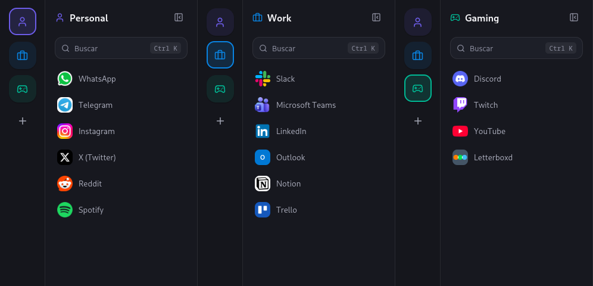
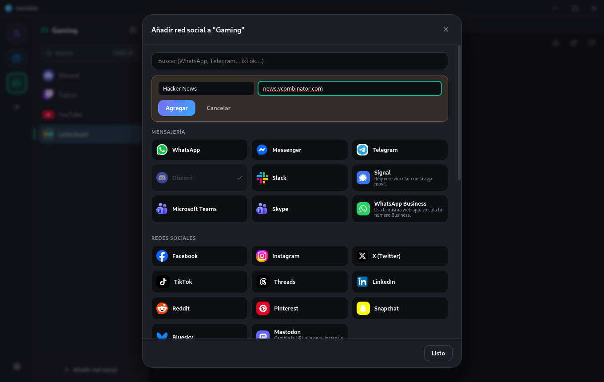

  

<h1 align="center">Socialite</h1>

  Your chats and social networks in one window, with a separate profile for each side of your life.

  
  

  

## What it is

Socialite puts WhatsApp, Telegram, Discord, Instagram, Slack and everything else in one desktop app, each one in its own tab in the sidebar. No more twenty browser tabs, no more getting logged out.

<table>
  <tr>
    <td width="55%"></td>
    <td width="45%">
      <h3>A profile for everything</h3>
      
Make as many profiles as you need, like Personal, Work or Gaming, each with its own icon, color and set of apps.

      
Profiles don't share anything, not even logins, so you can have your personal and your work WhatsApp open at the same time.

    </td>
  </tr>
  <tr>
    <td width="55%">
      <h3>Add any website</h3>
      
More than 35 services are ready to add in one click: messaging, social networks, email, video, music and work tools.

      
Missing one? Give it a name and its web address and it becomes one more tab, with its own icon and notifications.

    </td>
    <td width="45%"></td>
  </tr>
</table>

## Features

- **Stay logged in.** Close the app, open it again and you're still in, like a native app.
- **Notifications from your system**, with on/off switches for each profile and each service, and a *Do not disturb* schedule.
- **Unread counts** in the sidebar and on the app icon.
- **Jump anywhere** with <kbd>Ctrl</kbd>+<kbd>K</kbd>.
- **Dark mode for every site**, even the ones that don't have one.
- **Light on memory.** Services you don't use stay asleep until you open them. The ones you need notifications from can stay always on.
- **Built-in tracker blocking**, plus the extensions you already use in Chrome, Brave, Edge or Firefox (an ad blocker, for example).
- **Take your setup to another computer** by exporting and importing it.
- Lives in the system tray and can start with your computer.

## Limitations

- **Gmail and Google sign-in don't work.** Google deliberately blocks signing in from apps that embed websites, like Socialite. That's why Gmail isn't in the list, and signing in to other sites with your Google account may fail too. There's no reliable fix for this yet.
- The unread count comes from each page's title. Services that only change their icon won't show a number, although their notifications still arrive.
- The interface is in Spanish for now.

## Download

| System | Download | Notes |
|---|---|---|
| **Windows** | [Installer (.exe)](https://github.com/Amariless/Socialite-Releases/releases/download/v0.3.3/Socialite-Setup-0.3.3.exe) | Windows 10 or 11. |
| **Linux** | [AppImage](https://github.com/Amariless/Socialite-Releases/releases/download/v0.3.3/Socialite-0.3.3-linux-x86_64.AppImage) | Any distribution. Make it executable (`chmod +x`) and open it. |
| **Arch, CachyOS, Manjaro** | [Package (.pacman)](https://github.com/Amariless/Socialite-Releases/releases/download/v0.3.3/Socialite-0.3.3-linux-x64.pacman) | Install it with `sudo pacman -U` followed by the file name. |
| **Debian, Ubuntu, Mint** | [Package (.deb)](https://github.com/Amariless/Socialite-Releases/releases/download/v0.3.3/Socialite-0.3.3-linux-amd64.deb) | Double-click it or install it with `sudo apt install ./` followed by the file name. |

There's no macOS version yet. Older versions and release notes are on the [Releases](https://github.com/Amariless/Socialite-Releases/releases) page.

Socialite updates itself from this repository. You can also check for a new version in *Settings → About*.

## Feedback

Found a bug, have an idea or just want to say something? Each button opens a short form.

  
  
  

---

This repository only hosts the installers; the source code is private.
