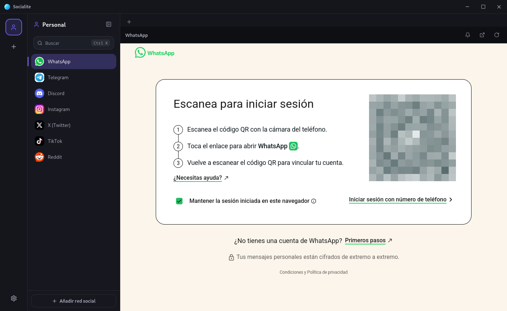

  

<h1 align="center">Socialite</h1>

  Tus chats, redes y correo en una sola ventana.

  <a href="../../releases/latest"><b>Descargar la última versión</b></a>
  &nbsp;·&nbsp; Windows &nbsp;·&nbsp; Linux

  

## Qué es

Socialite junta WhatsApp, Telegram, Discord, Instagram, Gmail y todo lo demás en una app de escritorio, cada servicio en su pestaña de la barra lateral. Se acabaron las veinte pestañas del navegador y los inicios de sesión que se pierden.

Puedes tener varios **perfiles** (por ejemplo Personal y Trabajo), cada uno con sus propias cuentas. Los perfiles y los servicios no comparten nada entre sí, así que puedes tener tu WhatsApp personal en un perfil y el del trabajo en otro, los dos abiertos a la vez.

## Lo que puedes hacer

- **Más de 35 servicios listos para añadir**: mensajería, redes sociales, correo, calendario, música y herramientas de trabajo. Si falta alguno, añádelo con su dirección web.
- **Mantener la sesión abierta.** Cierras la app y al volver sigues dentro, como en una app nativa.
- **Recibir notificaciones del sistema**, con control por perfil y por servicio, y un horario de *No molestar*.
- **Ver los mensajes sin leer** en la barra lateral y en el icono de la app.
- **Saltar entre servicios** con `Ctrl+K`.
- **Bloquear rastreadores** sin instalar nada, o usar las extensiones que ya tienes en Chrome, Brave, Edge o Firefox (por ejemplo, un bloqueador de anuncios).
- **Llevar tu configuración a otro equipo** exportándola e importándola.

## Instalación

Descarga el archivo de tu sistema desde [Releases](../../releases/latest):

| Sistema | Archivo |
|---|---|
| Windows | `Socialite-Setup-<versión>.exe` |
| Linux, cualquier distribución | `Socialite-<versión>-linux-x86_64.AppImage` (dale permiso de ejecución con `chmod +x`) |
| Arch, CachyOS, Manjaro | `Socialite-<versión>-linux-x64.pacman`, se instala con `sudo pacman -U <archivo>` |
| Debian, Ubuntu | `Socialite-<versión>-linux-amd64.deb` |

macOS no tiene versión por ahora.

La app se actualiza sola desde este repositorio. También puedes buscar una versión nueva en *Ajustes → Acerca de*.

## Bueno saber

- Algunos servicios de Google pueden mostrar un aviso de "navegador no compatible" en ciertos inicios de sesión con cuentas de terceros. Entrar directamente (por ejemplo, a Gmail) funciona sin problema.
- El contador de no leídos se basa en el título de cada página. Los servicios que solo cambian su icono no muestran número, aunque sus notificaciones llegan igual.

---

Este repositorio solo publica los instaladores; el código fuente es privado. Si algo falla o tienes una idea, abre un [issue](../../issues).
